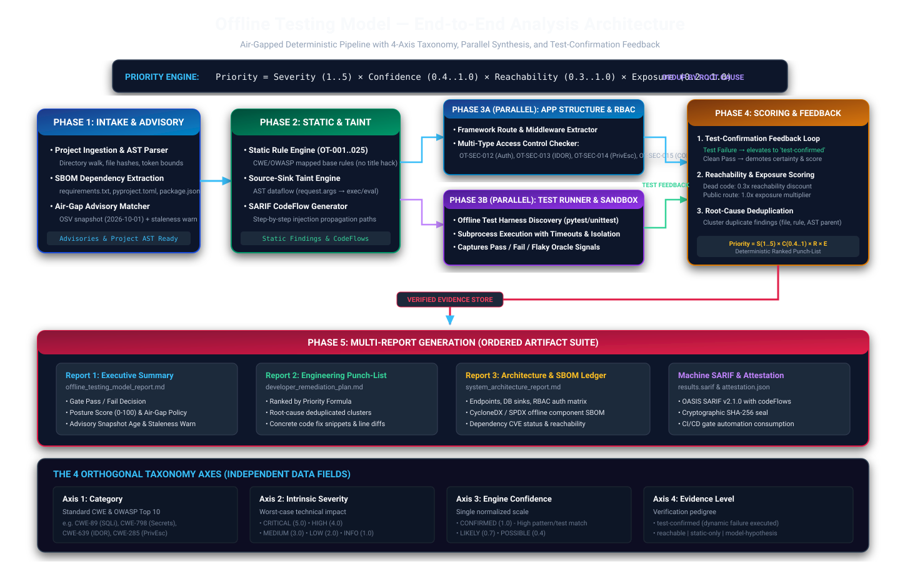
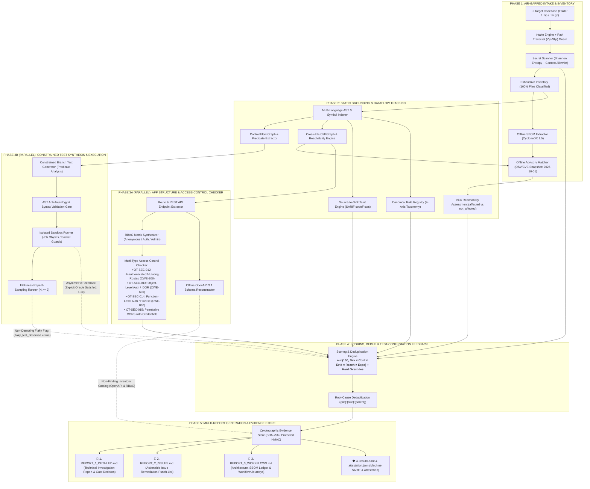

# Offline App and Website Testing Model (`offtest`)

> **Autonomous, 100% Air-Gapped Codebase Analysis, Neuro-Symbolic Test Synthesis, and Multi-Report Verification Engine**

[](https://python.org/)
[](LICENSE)
[](tests/)
[](BLUEPRINT.md)
[](offtest/checks/sandbox_interceptor.py)

---

## 📌 Executive Overview

**`offtest`** is an offline pipeline and verification engine engineered to ingest, catalog, analyze, and test application repositories **without sending a single byte of source code, configuration, secrets, or telemetry over external networks**.

Built directly against the **[Master Blueprint](file:///c:/Users/visha/Downloads/Testing%20model/BLUEPRINT.md)**, `offtest` implements a **Facts-First, Neuro-Symbolic Architecture**:
- **Deterministic Ground Truth:** Multi-language AST analysis, CycloneDX 1.5 SBOM extraction, offline OSV/CVE advisory matching, route/API parsing, and native OS sandboxing provide verifiable facts.
- **Source-to-Sink Taint Tracking:** Tracks injection paths through AST and emits OASIS SARIF `codeFlows` / `threadFlows`.
- **Reachability-Based VEX:** Evaluates imported symbols via cross-file call graphs to differentiate actionable `affected` dependencies from harmless `not_affected` lockfile entries.
- **Constrained Test Synthesis:** Generates self-healing branch tests for uncovered conditional logic without hallucinations or untracked claims.
- **Exposure-Weighted Priority Scoring:** Ranks defects by $\text{Severity} \times \text{Confidence} \times \text{Reachability} \times \text{Exposure}$.

---

## 🏗️ Architecture & Pipeline Flow

<p align="center">
  
</p>



> **Dataflow Convergence Clarification:**
> **Every security defect and finding source** (Static Rules, Source-to-Sink Taint, Secret Detections, RBAC Violations, and SCA VEX Advisories) **strictly converges into Phase 4 (Scoring Engine)** for normalized priority scoring, exploit oracle feedback, and root-cause deduplication. 
> The sole non-converging branch is the **Non-Finding Structural Catalog** (the reconstructed OpenAPI 3.1 JSON and raw RBAC matrix schemas extracted in Phase 3A), which routes directly to the Evidence Store to populate the architectural ledger of Report 3 without undergoing defect scoring.

### End-to-End Pipeline Stage Reference Table

| Phase | Core Engine Components | Primary Inputs | AppSec & Verification Function | Primary Outputs |
| :---: | :--- | :--- | :--- | :--- |
| **Phase 1: Intake & Advisory** | Intake Engine, Secret Scanner, SBOM Extractor, Advisory Matcher | Source directory or archive | Path traversal guard, high-entropy secret detection with context allowlisting, CycloneDX 1.5 SBOM extraction, offline OSV/CVE advisory matching with staleness auditing (`2026-10-01`, 90-day threshold) | Classified file catalog, redacting tokens, SBOM manifest, advisory age audit |
| **Phase 2: Static & Taint** | AST Indexer, Call Graph, Taint Tracker, Rule Registry | Analyzed source files, lockfiles | Cross-file symbol resolution, reachability analysis, source $\to$ sink taint propagation with step-by-step code flows, VEX reachability status (`affected` vs `not_affected`) | Call graph edges, SARIF `codeFlows`, VEX advisory findings (`OT-SUP-004`) |
| **Phase 3A: Structure & RBAC** | App Mapper, RBAC Synthesizer, OpenAPI Builder | AST trees, route decorators | Endpoint schema reconstruction, multi-type access control validation: unauthenticated mutating routes (`OT-SEC-012`), IDOR (`OT-SEC-013`), privilege escalation (`OT-SEC-014`), permissive CORS (`OT-SEC-015`) | OpenAPI 3.1 spec, workflow graphs, RBAC findings |
| **Phase 3B: Test Synthesis** | Branch Test Generator, Isolated Sandbox Runner | CFG predicates, branch conditions | Anti-tautological test synthesis, socket sinkhole execution (`127.0.0.1:9`), Windows Job Object containment, flakiness repeat-sampling ($N \ge 3$) | Synthesized test suites, execution verdicts, quarantined flaky tests |
| **Phase 4: Scoring & Feedback** | Test Feedback Loop, Scoring Engine, Dedup Clusterer | Static findings, executed test results | Correlates dynamic test failures to elevate confidence to `CONFIRMED` and `test-confirmed`; demotes flaky/clean tests; calculates $\text{Priority} = \text{Severity} \times \text{Confidence} \times \text{Reachability} \times \text{Exposure}$; clusters findings by root cause | Verified punch-list ranked by true risk |
| **Phase 5: Multi-Report** | Evidence Store & Multi-Report Generators | All observed verdicts & evidence | Cryptographic hashing (SHA-256/HMAC), SARIF 2.1.0 formatting with tags and `baselineState`, ordered multi-report generation | 4 synchronized audit reports: Executive Report, Remediation Plan, Architecture Dossier, `results.sarif` |

---

## 🌟 Core Capabilities

### 1. Strict Offline Air-Gap Enforcement
- **Multi-Layer Defense in Depth:** Active proxy sinkholes (`HTTP_PROXY`, `HTTPS_PROXY`, `ALL_PROXY`, `PIP_NO_INDEX=1`, `npm_config_offline=true`).
- **Python-Level Socket Interceptor:** Injects `sitecustomize.py` to block raw TCP (`connect`), UDP (`sendto`), and DNS (`getaddrinfo`) calls to non-loopback addresses while allowing safe local mocks (`127.0.0.1`, `localhost`).
- **Host Credential Isolation:** Redirects `USERPROFILE`, `HOME`, and `APPDATA` to ephemeral sandbox folders, preventing untrusted scripts from reading `~/.ssh` or `~/.aws`.
- **Windows Job Object Containment:** Native Windows Job Objects (`JOB_OBJECT_LIMIT_KILL_ON_JOB_CLOSE`) ensure that on timeout or cancellation, all child processes are killed cleanly with zero orphans.

#### 🛡️ Windows Sandbox Capabilities & Bare-Metal Boundaries
To prevent security ambiguity, the Windows sandbox enforcement model is explicitly bounded:
- **What the Windows Sandbox Isolates:**
  1. *Process-Tree Containment:* Native Win32 Job Objects assign `JOB_OBJECT_LIMIT_KILL_ON_JOB_CLOSE`, ensuring all spawned child and grandchild processes are terminated on timeout or cancellation.
  2. *Environment Variable Sanitization:* Child processes run with an explicit whitelist (`SAFE_ENV_WHITELIST`), stripping sensitive host environment variables (`AWS_*`, `GITHUB_*`, database URIs, API tokens).
  3. *User Profile Redirection:* Environment variables `USERPROFILE`, `HOME`, `HOMEDRIVE`, `HOMEPATH`, `APPDATA`, and `LOCALAPPDATA` are redirected to ephemeral temporary folders to shield `~/.ssh`, `~/.aws`, and user credentials.
  4. *Python-Level Socket Guarding:* Injects `sitecustomize.py` to block Python standard library socket connections to external addresses.
  5. *Offline Package Telemetry Sinkholing:* Disables package manager index lookups and analytics.
- **What the Windows Sandbox DOES NOT Isolate (Bare-Metal Windows Gaps):**
  1. *No Kernel Network Namespace:* Native executables, unpatched interpreters spawned with `-I -S` (which bypass `sitecustomize.py`), or direct Winsock APIs can access host network interfaces.
  2. *No Filesystem chroot/Jail:* Process can read host files via absolute paths (e.g. `C:\Users\...`) permitted by standard Windows user DACLs.
  3. *No User Privilege Boundary:* Child processes execute with the full privileges of the host user account.
- **Fail-Closed Execution Policy:**
  By default, all untrusted repository script execution and dynamic test execution **fail closed** on bare Windows and unisolated hosts (`CheckStatus.BLOCKED`, exit code 2). Project scripts will not run unless executed inside a verified container namespace (`docker run --network none ...`). The `--accept-no-kernel-isolation` override is strictly permitted for interactive developer diagnosis on throwaway VMs and is rejected in CI.

### 2. Offline Software Bill of Materials (SBOM)
- Scans `requirements.txt`, `package.json`, `package-lock.json`, `poetry.lock`, and `Cargo.lock`.
- Formats dependencies into CycloneDX 1.5-compatible offline component catalogs with license resolution and unpinned version alerts (`CWE-1357`).

### 3. 4-Axis Taxonomy, Calibrated Priority & CI Gate Policy
Findings are classified along four independent, orthogonal axes calibrated against empirical security benchmarks (**OWASP Benchmark v1.2** and **Securify Ground Truth sets**, evaluated quarterly):
1. **Category (Taxonomy):** Mapped to leaf CWE identifiers and OWASP Top 10 categories with primary and secondary tags (e.g. `OT-SEC-012` is `CWE-306` with secondary `[CWE-862, CWE-285]`, `OT-SEC-013` is `CWE-639` with secondary `[CWE-862, CWE-284]`, `OT-SEC-014` is `CWE-862` with secondary `[CWE-863, CWE-285]`).
2. **Intrinsic Severity:** Worst-case technical impact weight calibrated on a 100-point scale:
   - `CRITICAL` = **100.0**
   - `HIGH` = **70.0**
   - `MEDIUM` = **40.0**
   - `LOW` = **20.0**
   - `INFORMATIONAL` = **5.0**
3. **Rule Precision Confidence:** Calibrated static rule precision against ground-truth benchmarks (0.0 to 1.0):
   - `CONFIRMED` = **1.00** (Unambiguous AST / verified secret pattern with $>98\%$ measured benchmark precision)
   - `HIGH` / `LIKELY` = **0.85** (High-precision AST pattern match with $>90\%$ benchmark precision)
   - `MEDIUM` = **0.65** (Heuristic AST pattern with $>65\%$ benchmark precision)
   - `LOW` / `POSSIBLE` = **0.40** (Broad syntactic indicator with $<50\%$ precision)
4. **Evidence Level Multiplier:** Verification pedigree hierarchy (orthogonal; reachability is **not** double-counted here):
   - `test-confirmed` = **1.20x** (Actively reproduced by dynamic test exploit oracle across $N \ge 3$ runs)
   - `static-only` = **1.00x** (Deterministic AST or pattern baseline)
   - `model-hypothesis` = **0.50x** (Synthesized hypothesis, strictly capped at **25.0**, never triggers gate)
   *(Note: Flaky tests do **not** demote findings below the static baseline; findings retain `1.00x` with an annotated `flaky_test_observed` flag)*.

#### Normalized Priority Formula & Reach / Exposure Definitions
Remediation priority is computed deterministically on a normalized 0.0 to 100.0 scale:
$$\text{Priority (0..100)} = \min\left(100.0, \text{Severity (100..5)} \times \text{Confidence (1.0..0.4)} \times \text{Evidence Multiplier (1.2..0.5)} \times \text{Reachability (1.0..0.2)} \times \text{Exposure (1.0..0.2)}\right)$$

- **Reachability Factor:**
  - `proven` (**1.00**): Code symbol has a proven semantic AST call path from an application entry point. Non-code findings (active secrets, Dockerfile policies) default to **1.00**. Triggers Critical Hard Override floor.
  - `heuristic` (**1.00**): Code symbol reached via regex or lexical name matching from an entry point (e.g. TypeScript/React or Java lexical matches). Avoids the 0.20 unreachable discount, but does **not** trigger Critical Hard Override floors.
  - `unknown` (**1.00** or **0.70**): Dynamic imports, reflection, dependency injection, or incomplete call graph.
  - `unreachable` (**0.20**): Provably dead code (private unreferenced symbol with no project call sites).
- **Exposure Factor:**
  - `public_unauth` (**1.00**): Internet-facing route without auth decorators or public CLI entry point.
  - `public_auth` (**0.75**): Authenticated user-facing route or tenant API.
  - `internal` (**0.50**): Internal backend service, admin-only tool, or repository config.
  - `test_fixture` (**0.20**): Test mock, fixture, sample script, or documentation.

#### Calibrated Worked Examples
| Finding | Severity | Precision | Evidence | Reach | Exposure | Raw Score | Gate Outcome |
| :--- | :---: | :---: | :---: | :---: | :---: | :---: | :---: |
| **Critical, high-precision, static-only, proven reach, mid exposure** | 100 | 0.85 | 1.00 | 1.00 (proven) | 0.50 | **42.5** | **FAIL (Hard Override Floor ≥ 90.0)** |
| **Critical, high-precision, static-only, heuristic reach, mid exposure** | 100 | 0.85 | 1.00 | 1.00 (heuristic) | 0.50 | **42.5** | **PASS (Score < 45, Heuristic Edge Does Not Trigger Floor)** |
| **Critical, test-confirmed, medium-precision, reachable, internal** | 100 | 0.65 | 1.20 | 1.00 | 0.50 | **39.0** | **FAIL (Hard Override Floor ≥ 90.0)** |
| **Medium, test-confirmed, reachable, public** | 40 | 1.00 | 1.20 | 1.00 | 1.00 | **48.0** | **FAIL (Score ≥ 45.0)** |
| **Same medium, static-only, reachable, public** | 40 | 1.00 | 1.00 | 1.00 | 1.00 | **40.0** | **PASS (Score < 45.0)** |
| **Known-Exploited Vulnerability (CISA KEV)** | 40 | 0.85 | 1.00 | 0.20 | 0.50 | Floor **80.0** | **FAIL (Hard Override Floor ≥ 90.0)** |

#### CI/CD Release Gate Decision Table with Hard Overrides
The gate evaluates both numerical priority scores and **Hard Overrides** to prevent multiplicative shrinkage from bypassing genuine critical risks:

| Finding Type & Severity | Confidence & Evidence Level | Priority Score | Air-Gap Policy Breaches | Gate Decision | Rationale |
| :--- | :--- | :---: | :---: | :---: | :--- |
| `VULNERABILITY` / `SECRET` (Critical / High) | Confirmed (1.00), any verified level | Any | Any | **FAIL (Hard Override)** | Zero-tolerance for confirmed critical/high security risks |
| Proven Reachable Critical | Precision ≥ 0.85, Proven Reachability | Floor ≥ 90.0 | Any | **FAIL (Hard Override)** | Critical defect proven reachable from entry point |
| Known-Exploited (CISA KEV) | Any affected/unknown component | Floor ≥ 90.0 | Any | **FAIL (Hard Override)** | Active in-the-wild exploitation weaponization |
| Exposed Live Cloud Secret | Confirmed / Likely (`OT-SCR-001..003`) | Floor ≥ 90.0 | Any | **FAIL (Hard Override)** | Direct credential leak risk outside test fixtures |
| `POLICY` (Air-gap boundary breach) | Confirmed (1.00) or Likely (0.85) | Any | `OT-POL-001..007` | **FAIL (Hard Override)** | Zero-tolerance air-gap isolation boundary violation |
| `CORRECTNESS` (Syntax / Import crash) | Confirmed (1.00) | Any | Any | **FAIL (Hard Override)** | Broken application execution semantics |
| `VULNERABILITY` (Medium/Low) | Confirmed or Likely | ≥ 45.0 | None | **FAIL (Score-Based)** | High-exposure reachable flaw exceeding release threshold |
| `MODEL_HYPOTHESIS` | Any | Capped ≤ 25.0 | None | **PASS** | Speculative AI hypothesis; requires symbolic verification |
| `HYGIENE` / `SUPPLY_CHAIN` (Unpinned) | Any (Warn Rules) | < 45.0 | None | **PASS** | Maintenance/hygiene items do not block releases |
| Clean Scan | None | 0.0 | None | **PASS** | Clean verification ledger |

- **Unified Gate Model (Rule-Level vs Score-Based):**
  * `gate=False` (Warn): The rule is purely advisory (e.g. hygiene rules `OT-HYG-*`, CSRF `OT-SEC-030`, CORS `OT-SEC-035`, missing Helmet `OT-SEC-034`, unpinned dependencies `OT-SUP-001`). Findings under these rules NEVER block the CI release gate, regardless of their priority score.
  * `gate=True` (Block Candidate): Eligible to block the CI release gate if it triggers a Hard Override OR its calibrated priority score satisfies $\text{Priority} \ge 45.0$. A static-only High with imperfect confidence or lower exposure that scores $< 45.0$ and lacks a Hard Override will NOT block.
- **Entropy-Only Cap:** Findings detected solely by high Shannon entropy without provider-specific syntax or keyword context are capped at confidence `POSSIBLE` (0.40) and max priority score `35.0` (below the 45.0 blocking threshold).
- **Exit Status Taxonomy:**
  * `0`: Clean / Passed (No blocking security, policy, or correctness defects).
  * `1`: Failed (Blocking security defect, air-gap breach, or correctness flaw found in user code).
  * `2`: `ANALYSIS_INCOMPLETE` (Harness, internal synthesis crash, or execution refused due to missing isolation; strictly separated from defects in user code).
- **Top Score Tie-Breakers:** Findings capped at `100.0` break ties in remediation punch-lists by: `1st:` Intrinsic Severity (Critical > High > Medium), `2nd:` Exposure (Public Unauth > Public Auth > Internal), `3rd:` Confidence / Rule Precision.
- **Uniform Root-Cause Deduplication:** Findings sharing the same underlying cause use the uniform notation `{file}:{rule}:{parent}`. For cross-file shared helpers, findings cluster by `{origin_file}:{rule}:{helper_func}` with all cross-file call sites attached as SARIF `relatedLocations`. Line-independent `partialFingerprints["logicalLocationKey"]` ensure baseline diffing stability across edits.

### 4. Source-to-Sink Taint Engine & Analysis Depth Reality
- **Parser & Analysis Depth Disclosures:**
  * **Python:** Full semantic Python AST expression dataflow, symbol tables (`symtable`), and cross-file AST taint analysis (`SEMANTIC` depth across all axes).
  * **TypeScript / React:** Python-based regex and lexical component parser with pattern rules (`HEURISTIC` depth for symbols, reachability, and rules). Non-Python findings capped at `static-only`. Does not perform full JVM or V8 semantic dataflow taint analysis.
  * **Java / Spring Boot:** Python-based lexical and regex symbol & annotation visitor (reimplementation, not native JVM JavaParser binding) with Spring pattern rules (`HEURISTIC` depth). Spring DI beans treated as unknown/heuristic reachability.
  * **Go & Rust:** Parsed for offline SBOM dependency extraction (`go.mod`, `Cargo.lock`), but currently have **no language analyzers or rule adapters**.
- **Untrusted Sources (Python):** HTTP query params (`request.args`), JSON request bodies (`request.json`, `request.get_json()`), form data (`request.form`), headers, and route path parameters (`<user_id>`).
- **Dangerous Sinks (Python):** System command execution (`os.system`, `subprocess.Popen`, `subprocess.run`), SQL queries (`cursor.execute`, `.raw()`), dynamic evaluation (`eval`, `exec`), and path traversal (`open()`, `shutil`).
- **Recognized Sanitizers:** Defensive wrappers (`shlex.quote()`, parameterized DB tuples, `yaml.SafeLoader`).
- **SARIF CodeFlow Generation:** Emits full OASIS SARIF v2.1.0 `codeFlows` containing thread flow locations tracing data movement from source input to final sink.

### 5. Air-Gap Advisory Matcher, CISA KEV & Staleness Auditing
- Ingests embedded, 100% offline vulnerability advisories (OSV/CVE snapshot dated `2026-10-01`) enriched with CISA KEV and EPSS exploit probability scores.
- Evaluates dependency reachability via cross-file import call graphs to assign OpenVEX status:
  - `affected`: The vulnerable package is imported and referenced in live application code.
  - `not_affected`: The package is merely present in lockfiles but dead/unreferenced.
- **CISA KEV Score Integration:** Known-exploited CVEs trigger a floor priority score of **80.0** and invoke a mandatory Gate Hard Override (priority floor ≥ 90.0).
- **Staleness Guard Policy:** If the offline advisory snapshot exceeds `ADVISORY_STALENESS_THRESHOLD_DAYS` (90 days):
  - Standard mode: Emits warning finding `OT-SUP-006` with an executive audit warning.
  - Strict mode (`--strict-policy`): Halts the build with a CI Gate Fail.

### 6. Canonical Rule Registry (64 Rules Across 6 Domains)
The canonical rule catalog contains **64 rules** organized with distinct functional domain prefixes, eliminating rule ID collisions:
- **Security Vulnerability Rules (`OT-SEC-001..035` - 35 rules):**
  * `OT-SEC-001..011`: Core injection and execution vulnerabilities (Command injection, SQLi, SSRF, XSS, Path traversal, Insecure deserialization).
  * `OT-SEC-012`: Unauthenticated mutating route (`CWE-306`).
  * `OT-SEC-013`: Object-Level Auth / IDOR (`CWE-639`).
  * `OT-SEC-014`: Function-Level Auth / PrivEsc (`CWE-862`).
  * `OT-SEC-015`: Permissive CORS with credentials.
  * `OT-SEC-016..020`: Mass assignment (`CWE-915`), Insecure JWT (`CWE-345`), Missing CSRF (`CWE-352`), Rate limiting (`CWE-307`), Cryptographic misuse (`CWE-327`).
  * `OT-SEC-021..026`: JavaScript prototype pollution (`CWE-1321`), Axios SSRF (`CWE-918`), React XSS (`CWE-79`), Browser-facing secret leak (`CWE-526`), PostMessage origin (`CWE-346`), Node fs path traversal (`CWE-22`).
  * `OT-SEC-027..028`: Java SQLi (`CWE-89`), Java XXE (`CWE-611`).
  * `OT-SEC-029`: Missing method-level security on Spring controller (`CWE-862`), verified with SecurityFilterChain config-level check.
  * `OT-SEC-030`: CSRF protection disabled in Spring Security (`CWE-352`, Warn).
  * `OT-SEC-031`: Hardcoded credentials in Spring configuration (`CWE-798`), ignoring placeholders (`${...}`) and changeme.
  * `OT-SEC-032..034`: Node NoSQL injection (`CWE-943`), Node child_process (`CWE-78`), Missing Helmet security headers (`CWE-693`, Warn).
  * `OT-SEC-035`: Permissive Spring CORS with credentials (`CWE-942`, Warn).
- **Air-Gap Policy Rules (`OT-POL-001..007` - 7 rules):**
  * Network socket calls (`OT-POL-002`), External URL references (`OT-POL-001`), Unpinned base images (`OT-POL-003`), Telemetry (`OT-POL-004`), Root user (`OT-POL-005`), Mutable GitHub Action refs (`OT-POL-006`), Privileged containers (`OT-POL-007`).
- **Secret Exposure Rules (`OT-SCR-001..004` - 4 rules):**
  * AWS keys (`OT-SCR-001`), Generic API keys (`OT-SCR-002`), Private keys (`OT-SCR-003`), High-entropy tokens (`OT-SCR-004`).
- **Software Supply Chain Rules (`OT-SUP-001..006` - 6 rules):**
  * Unpinned dependencies (`OT-SUP-001`), Typosquatting (`OT-SUP-002`), Known vulnerabilities (`OT-SUP-003`), VEX reachability (`OT-SUP-004`), Copyleft licenses (`OT-SUP-005`), Stale advisories (`OT-SUP-006`).
- **Hygiene Rules (`OT-HYG-001..008` - 8 rules):**
  * Debug flags (`OT-HYG-001`), Production assert (`OT-HYG-002`), Broad exceptions (`OT-HYG-003`), Print debugging (`OT-HYG-004`), Unused imports (`OT-HYG-005`), Dead code (`OT-HYG-006`), Sensitive logging (`OT-HYG-007`), Insecure tempfiles (`OT-HYG-008`).
- **Code Correctness Rules (`OT-COR-001..004` - 4 rules):**
  * Syntax errors (`OT-COR-001`), Undefined variables (`OT-COR-002`), Zero division (`OT-COR-003`), Incompatible types (`OT-COR-004`).

### 7. Implementation Status of External Review Changes (Changes 1 to 6)

| Change | Specification Item | Status | Verification & Evidence |
| :---: | :--- | :---: | :--- |
| **Change 1** | File Filtering, Value-Only Entropy, `.d.ts` Skipping & Comments | **Done** | `tests/test_scanner_changes_review.py` verifies value-only Shannon entropy, comments down-weighted to POSSIBLE/Informational, `.d.ts` excluded. |
| **Change 2** | Three-State Reachability & Proven vs Heuristic Split | **Done** | `offtest/core/project_index.py` & `offtest/core/models.py`: Proven edges trigger Hard Override Floor ≥ 90.0; Heuristic edges avoid 0.20 discount but do not trigger floor. |
| **Change 3** | Symbol Resolution via symtable & Dead Code Verification | **Done** | `offtest/checks/static_checks.py` & `project_index.py`: Dead code flagged only on private, unreferenced, non-decorated symbols via symtable scoping. |
| **Change 4** | Route Auth Detection (`Depends`, decorators) & `--app-tier` | **Done** | `offtest/checks/static_checks.py`: Detects FastAPI `Depends`, Flask `@login_required`, Spring config filter chains; propagates `--app-tier` to exposure. |
| **Change 5** | Gate Hard Overrides Floor, Entropy Cap & `ANALYSIS_INCOMPLETE` | **Done** | `offtest/checks/planner.py`: Floor ≥ 90.0 on Hard Overrides; entropy-only capped at 35.0 (non-blocking); exit code 2 on analysis incomplete. |
| **Change 6** | Regression Fixtures & "Must Still Flag" Ground Truth | **Done** | `tests/test_scanner_changes_review.py`: Verified against named test fixtures (Page 8 regression suite, `test_planted_issues.py`, `test_multi_language_adapters.py`). |
- **Application Security Controls:**
  - `OT-SEC-015`: Permissive CORS wildcard origins (`*`) configured simultaneously with credential sharing.
  - `OT-SEC-016`: Mass assignment / unbounded request body unpacking (`**request.json`) into model constructors (`CWE-915`).
  - `OT-SEC-017`: Insecure JWT/session configuration (`verify=False`, `none` algorithm, missing `exp` enforcement).
  - `OT-SEC-018`: Missing CSRF protection on cookie-authenticated state-changing routes (`CWE-352`).
  - `OT-SEC-019`: Missing rate limiting on authentication/login endpoints (`CWE-307`).
  - `OT-SEC-020`: Cryptographic misuse (AES-ECB mode, weak RSA < 2048, MD5/SHA1 for sensitive tokens).
- **Infrastructure as Code (IaC) & Policy:**
  - `OT-POL-005`: Dockerfile executing as default `root` user without a dedicated `USER` directive.
  - `OT-POL-006`: GitHub Actions workflows referencing mutable branch/tag refs (`@v4`, `@main`) instead of cryptographic 40-character commit SHAs.
  - `OT-POL-007`: Privileged container mode (`privileged: true` / `--privileged`) in Docker Compose / IaC configs.
  - `OT-SUP-005`: Copyleft license risk (GPL, AGPL) in commercial target codebases.
- **Git-History Secret Scanning:** Walks local git commit history and staging diffs to detect committed credentials, private keys, and API tokens.
- **Timed Inline Suppressions:** Parses `# offtest: ignore[RULE_ID] reason="..." expires="YYYY-MM-DD"`. If the expiry date has passed, the suppression is automatically invalidated and the finding remains active.
- **Model Immunity Rule:** Scanned repository content is wrapped in nonce fences (`<untrusted_repo_content token="...">`). Speculative AI hypotheses can never trigger CI failures without symbolic confirmation.

### 7. Exploit Oracle Satisfied Dynamic Feedback Loop
Dynamic test results calibrate static findings with asymmetric confidence semantics:
- **Exploit Oracle Satisfied:** When a synthesized or existing unit test executes and satisfies an exploit oracle (reproducing vulnerability behavior across $N \ge 3$ runs, distinct from generic syntax/environment crashes), the finding is elevated to `confidence = CONFIRMED` (1.00) and `evidence_level = "test-confirmed"` (1.20x multiplier).
- **Weak Negative Non-Demotion:** When a test passes cleanly, it does **NOT** demote deterministic static rule findings, because auto-generated tests may simply lack assertion depth or branch coverage. Only unverified `model-hypothesis` findings are gently nudged down to `POSSIBLE`.
- **Non-Demoting Flakiness Flag:** Non-deterministic tests quarantined during repeat-sampling ($N \ge 3$) do **not** demote the finding below its static-only baseline (`1.00x`). The finding retains its static score, annotated with `flaky_test_observed = True` and SARIF property `flakyTestObserved: true`.

### 4. Constrained Branch Test Synthesis & Self-Healing
- Analyzes Abstract Syntax Tree (AST) conditional predicates (null checks, range comparisons, boolean guards).
- Synthesizes syntax-validated, target-specific unit test suites.
- Gates tests against an AST anti-tautology filter to ensure tests assert genuine behavioral requirements.

### 5. Flakiness Repeat Sampling & Quarantine Runner
- Runs test suites across multiple repeat iterations ($N \ge 3$) under isolated environments.
- Automatically isolates and quarantines non-deterministic/flaky tests to prevent blocking release pipelines.

### 6. 7-Dimension Honest Coverage Model
The model accounts for testing coverage honestly with explicit denominators and documented gap reasons:
1. **Repository Inventory Coverage:** Percentage of repository files classified and inspected.
2. **Static Analysis Coverage:** Percentage of parseable code files subjected to security and syntax rules.
3. **Test Suite Execution Coverage:** Discovered vs. executed vs. blocked test suites.
4. **Statement/Branch Code Coverage:** Explicitly marked `Unavailable` if no offline LCOV/cobertura artifact exists (zero false claims).
5. **Workflow Coverage:** Documented end-to-end user workflows tested.
6. **Feature Coverage:** Identified features with verified test anchors.
7. **Branch Predicate Coverage:** Conditional branches exercised vs. synthesized.

---

## 🚀 Quickstart & Direct Execution

### 1. Prerequisites
- **Python 3.10+** (Standard Library, `click`, and `pydantic`)
- **Git** (for local revision and branch diffing)

Install in editable mode:
```powershell
pip install -e .
```

---

### 2. CLI Usage

#### Standard Assessment
Assess any local repository or directory (e.g. your application or the sample web app):
```powershell
python -m offtest assess "C:\path\to\your\project"
```

#### Assessment with Flakiness Quarantine
Perform multi-run repeat sampling ($N \ge 3$) to detect and quarantine non-deterministic tests:
```powershell
python -m offtest assess "C:\path\to\your\project" --detect-flaky
```

#### Approve Script Execution on Bare Host (Developer Diagnostic Mode Only)
By default, untrusted scripts and test suites are blocked from running on bare metal (fail-closed). To run local project test suites on a bare host without container isolation:
```powershell
python -m offtest assess "C:\path\to\your\project" --allow-scripts --accept-no-kernel-isolation
```
> [!CAUTION]
> **Host Isolation Boundary Warning:** Passing `--allow-scripts --accept-no-kernel-isolation` permits target repository test code to execute directly on the host machine. While environment variables and profiles are scrubbed, bare-metal OS execution does not provide kernel network namespace or chroot filesystem isolation. This mode is restricted to interactive local developer diagnosis in throwaway VMs and is strictly refused in automated CI environments. In CI, run inside a verified container (`docker run --network none ...`).

#### Save Reports to a Dedicated Folder
Specify custom output directories matching your project:
```powershell
python -m offtest assess "C:\path\to\your\project" --out "my_project_reports"
```

#### Reproduce Reports from Existing Evidence
Reconstruct Markdown and SARIF reports from saved runs without re-running checks:
```powershell
python -m offtest report run_20261024_072830_f0ea80 --out "./reproduced_reports"
```

#### Verify Offline Air-Gap Controls
Test socket sinkholes, DNS blocking, and host isolation on your current environment:
```powershell
python -m offtest verify-offline
```

#### View Offline Tool Manifest
List all discovered compilers, runtimes, linters, and packages installed locally:
```powershell
python -m offtest manifest
```

---

## 📂 Generated Report Outputs

Every assessment produces four synchronized artifacts strictly numbered and cross-referenced:

1. **`REPORT_1_DETAILED.md` (Technical Investigation Report):**  
   Exhaustive 10-section report detailing file dispositions, complete CycloneDX SBOM, OpenAPI specifications, RBAC matrix, local git branch diffs, execution logs, and the 7-dimension coverage breakdown.

2. **`REPORT_2_ISSUES.md` (Actionable Issue-Focused Report):**  
   Actionable punch-list sorted descending by **Exposure-Weighted Priority Score**:
   $$\text{Priority Score} = \text{Severity} \times \text{Confidence} \times \text{Reachability} \times \text{Exposure}$$
   Includes stable fingerprint IDs (`FIND-{rule_id}-{hash}`), CWE taxonomy, OWASP Top 10 tags, ASVS v4.0 chapters, estimated CVSS v3.1 base vectors, line numbers, and actionable remediation actions.

3. **`REPORT_3_WORKFLOWS.md` (Application Workflow & Journey Report):**  
   Catalog of end-to-end user journeys, reactive state management pipelines, routing transitions, interactive Mermaid diagrams, failure-mode analysis, and workflow test coverage gaps.

4. **`results.sarif` (OASIS SARIF 2.1.0):**  
   Standard static analysis results format compatible with GitHub Code Scanning, SonarQube, and CI/CD security dashboards, containing source-to-sink `codeFlows`, `threadFlows`, OWASP/ASVS tags, and inline suppression records.

---

## 📁 Repository Directory Structure

```
Testing model/
├── offtest/
│   ├── core/
│   │   ├── config.py              # Timeouts, environment flags, sensitive data regexes
│   │   ├── models.py              # Pydantic data schemas (SBOM, RBAC, Findings, Inventory)
│   │   └── evidence_store.py      # Immutable JSON evidence store & cryptographic verification
│   ├── intake/
│   │   ├── intake.py              # Directory & archive intake with Zip-Slip path sanitization
│   │   ├── git_manager.py         # Local-only Git branch and tag comparison
│   │   └── safety.py              # Shannon entropy secret scanner & token redaction
│   ├── inventory/
│   │   ├── classifier.py          # Dispositions (analyzed, excluded, binary, generated)
│   │   ├── engine.py              # Exhaustive file crawler
│   │   └── sbom.py                # CycloneDX 1.5 offline dependency extractor
│   ├── discovery/
│   │   ├── app_mapper.py          # Route, API, and workflow discovery
│   │   └── rbac_and_schema.py     # RBAC permission matrix & OpenAPI 3.1 synthesizer
│   ├── generator/
│   │   └── test_generator.py      # AST conditional predicate parser & test synthesizer
│   ├── checks/
│   │   ├── isolated_runner.py     # Subprocess containment, Windows Job Objects & proxy sinkholes
│   │   ├── sandbox_interceptor.py # sitecustomize.py raw TCP/UDP/DNS socket blocker
│   │   ├── static_checks.py       # AST syntax validator, dangerous call checks, unpinned deps
│   │   ├── test_adapter.py        # Framework discovery (pytest, unittest, jest)
│   │   ├── flakiness.py           # Multi-run repeat sampling & test quarantine engine
│   │   └── planner.py             # Check orchestrator & offline toolchain manifest
│   ├── coverage/
│   │   └── evaluator.py           # 7-dimension coverage accounting with explicit gap tracking
│   ├── reports/
│   │   ├── detailed.py            # Report 1 (Exhaustive technical document)
│   │   └── issue_focused.py       # Report 2 (Actionable punch-list)
│   ├── orchestrator.py            # End-to-end multi-stage pipeline coordinator
│   └── cli.py                     # Click-based CLI entrypoint
├── tests/                         # Pytest test suite (73 tests covering all 16 components)
├── sample_repos/                  # Fixture applications used for regression and smoke testing
├── BLUEPRINT.md                   # Formal specification & architectural blueprint
└── pyproject.toml                 # Package configuration & dependencies
```

---

## 🧪 Running the Test Suite

To run all 73 self-tests verifying air-gap isolation, secret redactors, AST parsers, and report generators:

```powershell
python -m pytest
```

---

## ⚖️ Acceptance Criteria Conformance

| Acceptance Criterion | Verification Status | Implementation Engine |
| :--- | :---: | :--- |
| **Strict Offline Networking** | ✅ Verified | `IsolatedRunner` + `sandbox_interceptor.py` + sinkhole proxies |
| **Offline CycloneDX SBOM** | ✅ Verified | `SBOMGenerator` (npm, pip, cargo, poetry) |
| **RBAC Matrix Discovery** | ✅ Verified | `RBACAndSchemaExtractor` |
| **OpenAPI 3.1 Synthesis** | ✅ Verified | `OpenAPISpecRecord` generator |
| **Flakiness Quarantine** | ✅ Verified | `FlakinessRepeatSampler` ($N \ge 3$) |
| **Branch Test Synthesis** | ✅ Verified | `ConstrainedTestGenerator` (AST condition solver) |
| **100% File Classification** | ✅ Verified | `InventoryEngine` (all files assigned explicit dispositions) |
| **Zero Remote Git Fetches** | ✅ Verified | `GitManager` (strictly local refs and diffs) |
| **Dual Synchronized Reports**| ✅ Verified | Generated simultaneously from unified `evidence.json` |
| **Report Reproducibility** | ✅ Verified | `python -m offtest report <run_id>` |
