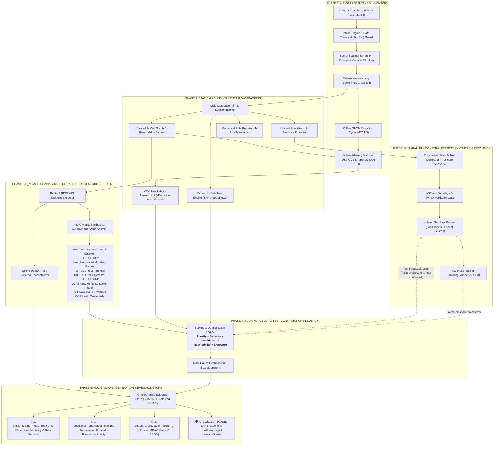

# Offline App and Website Testing Model (`offtest`)

> **Autonomous, 100% Air-Gapped Codebase Analysis, Neuro-Symbolic Test Synthesis, and Multi-Report Verification Engine**

[](https://python.org/)
[](LICENSE)
[](tests/)
[](BLUEPRINT.md)
[](offtest/checks/sandbox_interceptor.py)

---

## 📌 Executive Overview

**`offtest`** is an offline pipeline and verification engine engineered to ingest, catalog, analyze, and test application repositories **without sending a single byte of source code, configuration, secrets, or telemetry over external networks**.

Built directly against the **[Master Blueprint](file:///c:/Users/visha/Downloads/Testing%20model/BLUEPRINT.md)**, `offtest` implements a **Facts-First, Neuro-Symbolic Architecture**:
- **Deterministic Ground Truth:** Multi-language AST analysis, CycloneDX 1.5 SBOM extraction, offline OSV/CVE advisory matching, route/API parsing, and native OS sandboxing provide verifiable facts.
- **Source-to-Sink Taint Tracking:** Tracks injection paths through AST and emits OASIS SARIF `codeFlows` / `threadFlows`.
- **Reachability-Based VEX:** Evaluates imported symbols via cross-file call graphs to differentiate actionable `affected` dependencies from harmless `not_affected` lockfile entries.
- **Constrained Test Synthesis:** Generates self-healing branch tests for uncovered conditional logic without hallucinations or untracked claims.
- **Exposure-Weighted Priority Scoring:** Ranks defects by $\text{Severity} \times \text{Confidence} \times \text{Reachability} \times \text{Exposure}$.

---

## 🏗️ Architecture & Pipeline Flow

<p align="center">
  
</p>



### End-to-End Pipeline Stage Reference Table

| Phase | Core Engine Components | Primary Inputs | AppSec & Verification Function | Primary Outputs |
| :---: | :--- | :--- | :--- | :--- |
| **Phase 1: Intake & Advisory** | Intake Engine, Secret Scanner, SBOM Extractor, Advisory Matcher | Source directory or archive | Path traversal guard, high-entropy secret detection with context allowlisting, CycloneDX 1.5 SBOM extraction, offline OSV/CVE advisory matching with staleness auditing (`2026-10-01`, 90-day threshold) | Classified file catalog, redacting tokens, SBOM manifest, advisory age audit |
| **Phase 2: Static & Taint** | AST Indexer, Call Graph, Taint Tracker, Rule Registry | Analyzed source files, lockfiles | Cross-file symbol resolution, reachability analysis, source $\to$ sink taint propagation with step-by-step code flows, VEX reachability status (`affected` vs `not_affected`) | Call graph edges, SARIF `codeFlows`, VEX advisory findings (`OT-SUP-004`) |
| **Phase 3A: Structure & RBAC** | App Mapper, RBAC Synthesizer, OpenAPI Builder | AST trees, route decorators | Endpoint schema reconstruction, multi-type access control validation: unauthenticated mutating routes (`OT-SEC-012`), IDOR (`OT-SEC-013`), privilege escalation (`OT-SEC-014`), permissive CORS (`OT-SEC-015`) | OpenAPI 3.1 spec, workflow graphs, RBAC findings |
| **Phase 3B: Test Synthesis** | Branch Test Generator, Isolated Sandbox Runner | CFG predicates, branch conditions | Anti-tautological test synthesis, socket sinkhole execution (`127.0.0.1:9`), Windows Job Object containment, flakiness repeat-sampling ($N \ge 3$) | Synthesized test suites, execution verdicts, quarantined flaky tests |
| **Phase 4: Scoring & Feedback** | Test Feedback Loop, Scoring Engine, Dedup Clusterer | Static findings, executed test results | Correlates dynamic test failures to elevate confidence to `CONFIRMED` and `test-confirmed`; demotes flaky/clean tests; calculates $\text{Priority} = \text{Severity} \times \text{Confidence} \times \text{Reachability} \times \text{Exposure}$; clusters findings by root cause | Verified punch-list ranked by true risk |
| **Phase 5: Multi-Report** | Evidence Store & Multi-Report Generators | All observed verdicts & evidence | Cryptographic hashing (SHA-256/HMAC), SARIF 2.1.0 formatting with tags and `baselineState`, ordered multi-report generation | 4 synchronized audit reports: Executive Report, Remediation Plan, Architecture Dossier, `results.sarif` |

---

## 🌟 Core Capabilities

### 1. Strict Offline Air-Gap Enforcement
- **Multi-Layer Defense in Depth:** Active proxy sinkholes (`HTTP_PROXY`, `HTTPS_PROXY`, `ALL_PROXY`, `PIP_NO_INDEX=1`, `npm_config_offline=true`).
- **Python-Level Socket Interceptor:** Injects `sitecustomize.py` to block raw TCP (`connect`), UDP (`sendto`), and DNS (`getaddrinfo`) calls to non-loopback addresses while allowing safe local mocks (`127.0.0.1`, `localhost`).
- **Host Credential Isolation:** Redirects `USERPROFILE`, `HOME`, and `APPDATA` to ephemeral sandbox folders, preventing untrusted scripts from reading `~/.ssh` or `~/.aws`.
- **Windows Job Object Containment:** Native Windows Job Objects (`JOB_OBJECT_LIMIT_KILL_ON_JOB_CLOSE`) ensure that on timeout or cancellation, all child processes are killed cleanly with zero orphans.

### 2. Offline Software Bill of Materials (SBOM)
- Scans `requirements.txt`, `package.json`, `package-lock.json`, `poetry.lock`, and `Cargo.lock`.
- Formats dependencies into CycloneDX 1.5-compatible offline component catalogs with license resolution and unpinned version alerts (`CWE-1357`).

### 3. 4-Axis Taxonomy & Priority Formula
Findings are classified along four independent, orthogonal axes rather than mixed into a single arbitrary scale:
1. **Category (Taxonomy):** Mapped to standard CWE identifiers and OWASP Top 10 categories (e.g. `CWE-89` SQL Injection, `CWE-798` Hardcoded Credentials, `CWE-639` Object Auth/IDOR, `CWE-285` Function Auth/PrivEsc, `CWE-915` Mass Assignment).
2. **Intrinsic Severity:** Worst-case technical impact weight calibrated against enterprise benchmarks:
   - `CRITICAL` = **10.0**
   - `HIGH` = **7.0**
   - `MEDIUM` = **4.0**
   - `LOW` = **2.0**
   - `INFORMATIONAL` = **0.5**
3. **Engine Confidence:** Single normalized certainty scale (0.0 to 1.0):
   - `CONFIRMED` = **1.0** (Deterministic high-pattern or test-corroborated match)
   - `HIGH` = **0.9**
   - `LIKELY` = **0.8**
   - `MEDIUM` = **0.6**
   - `POSSIBLE` / `LOW` = **0.4**
4. **Evidence Level:** Verification pedigree hierarchy:
   - `test-confirmed`: Actively reproduced or asserted by dynamic test execution.
   - `reachable`: Connected to an external entry point (HTTP route, CLI, public API) via cross-file call graph.
   - `static-only`: Syntax/AST pattern match without dynamic verification.
   - `model-hypothesis`: Synthesized by a neural model, requiring symbolic validation before confirmation.

Remediation priority is computed deterministically:
$$\text{Priority} = \text{Severity Weight (10..0.5)} \times \text{Confidence (0.4..1.0)} \times \text{Reachability Factor (1.0..0.2)} \times \text{Exposure Factor (1.5..0.2)}$$

- **Reachability Multipliers:** `reachable` (**1.0**), `unknown` (**0.7**), `unreachable` / dead code (**0.2**).
- **Exposure Multipliers:** `public_unauth` (**1.5**), `public_auth` (**1.0**), `internal` (**0.6**), `test_fixture` (**0.2**).
- **Score Spectrum & Thresholds:** Scores range from **0.04** (Info in test fixture) up to **15.0** (Confirmed Critical in unauthenticated public route). Any defect scoring $\ge \mathbf{7.0}$ triggers mandatory release blocking.
- **Root-Cause Deduplication:** Findings sharing the same underlying cause (`file_path::rule_id::parent_symbol`) are deduplicated into singular remediation tasks to eliminate alert fatigue.

### 4. Source-to-Sink Taint Engine & SARIF CodeFlows
- **Supported Languages & Scope:** Full Python AST expression dataflow and JS/TS regex dataflow.
- **Untrusted Sources:** HTTP query params (`request.args`), JSON request bodies (`request.json`, `request.get_json()`), form data (`request.form`), headers, and route path parameters (`<user_id>`).
- **Dangerous Sinks:** System command execution (`os.system`, `subprocess.Popen`, `subprocess.run`), SQL queries (`cursor.execute`, `.raw()`), dynamic evaluation (`eval`, `exec`), and path traversal (`open()`, `shutil`).
- **Recognized Sanitizers:** Defensive wrappers (`shlex.quote()`, parameterized DB tuples, `yaml.SafeLoader`).
- **SARIF CodeFlow Generation:** Emits full OASIS SARIF v2.1.0 `codeFlows` containing thread flow locations tracing data movement from source input to final sink.

### 5. Air-Gap Advisory Matcher & Staleness Auditing
- Ingests embedded, 100% offline vulnerability advisories (OSV/CVE snapshot dated `2026-10-01`).
- Evaluates dependency reachability via cross-file import call graphs to assign OpenVEX status:
  - `affected`: The vulnerable package is imported and referenced in live application code.
  - `not_affected`: The package is merely present in lockfiles but dead/unreferenced.
- **Staleness Guard:** If the offline advisory snapshot exceeds `ADVISORY_STALENESS_THRESHOLD_DAYS` (90 days), the system actively generates finding `OT-SUP-006` with a warning in executive reports, preventing false security assumptions.

### 6. Expanded Access Control, Auth & Infrastructure Governance
- **Function-Level vs. Object-Level Authorization:**
  - `OT-SEC-013` (Object-Level / IDOR): Direct database lookup using user-supplied keys without tenant/user ownership checks (`CWE-639`).
  - `OT-SEC-014` (Function-Level / PrivEsc): Administrative routes (`/admin/*`, `/manage/*`) lacking role checks (`CWE-285`).
- **Application Security Controls:**
  - `OT-SEC-012`: Unauthenticated mutating routes (`POST`, `PUT`, `DELETE`, `PATCH` without auth decorators).
  - `OT-SEC-015`: Permissive CORS wildcard origins (`*`) configured simultaneously with credential sharing.
  - `OT-SEC-016`: Mass assignment / unbounded request body unpacking (`**request.json`) into model constructors (`CWE-915`).
  - `OT-SEC-017`: Insecure JWT/session configuration (`verify=False`, `none` algorithm, missing `exp` enforcement).
  - `OT-SEC-018`: Missing CSRF protection on cookie-authenticated state-changing routes (`CWE-352`).
  - `OT-SEC-019`: Missing rate limiting on authentication/login endpoints (`CWE-307`).
  - `OT-SEC-020`: Cryptographic misuse (AES-ECB mode, weak RSA < 2048, MD5/SHA1 for sensitive tokens).
- **Infrastructure as Code (IaC) & Policy:**
  - `OT-POL-005`: Dockerfile executing as default `root` user without a dedicated `USER` directive.
  - `OT-POL-006`: GitHub Actions workflows referencing mutable branch/tag refs (`@v4`, `@main`) instead of cryptographic 40-character commit SHAs.
  - `OT-POL-007`: Privileged container mode (`privileged: true` / `--privileged`) in Docker Compose / IaC configs.
  - `OT-SUP-005`: Copyleft license risk (GPL, AGPL) in commercial target codebases.
- **Git-History Secret Scanning:** Walks local git commit history and staging diffs to detect committed credentials, private keys, and API tokens.
- **Timed Inline Suppressions:** Parses `# offtest: ignore[RULE_ID] expires="YYYY-MM-DD"`. If the expiry date has passed, the suppression is automatically invalidated and the finding is flagged as active.
- **Model Input Hardening:** Wraps untrusted source code and comments inside cryptographically nonce-fenced delimiters (`<untrusted_repo_content token="...">`), neutralizing prompt injection payloads in scanned code.

### 7. Asymmetric Test-Confirmation Feedback Loop
Dynamic test results calibrate static findings with asymmetric confidence semantics:
- **Strong Positive Corroboration:** When a synthesized or existing unit test executes and fails on a defect's target file/function, the finding is elevated to `confidence = CONFIRMED` (1.0) and `evidence_level = "test-confirmed"`.
- **Weak Negative Non-Demotion:** When a test passes cleanly, it does **NOT** demote deterministic static rule findings, because auto-generated tests may simply lack assertion depth or branch coverage. Only unverified `model-hypothesis` findings are gently nudged down to `POSSIBLE`.
- **Flakiness Quarantine Demotion:** Non-deterministic tests quarantined during repeat-sampling ($N \ge 3$) demote finding certainty to `evidence_level = "flaky-test"`.

### 4. Constrained Branch Test Synthesis & Self-Healing
- Analyzes Abstract Syntax Tree (AST) conditional predicates (null checks, range comparisons, boolean guards).
- Synthesizes syntax-validated, target-specific unit test suites.
- Gates tests against an AST anti-tautology filter to ensure tests assert genuine behavioral requirements.

### 5. Flakiness Repeat Sampling & Quarantine Runner
- Runs test suites across multiple repeat iterations ($N \ge 3$) under isolated environments.
- Automatically isolates and quarantines non-deterministic/flaky tests to prevent blocking release pipelines.

### 6. 7-Dimension Honest Coverage Model
The model accounts for testing coverage honestly with explicit denominators and documented gap reasons:
1. **Repository Inventory Coverage:** Percentage of repository files classified and inspected.
2. **Static Analysis Coverage:** Percentage of parseable code files subjected to security and syntax rules.
3. **Test Suite Execution Coverage:** Discovered vs. executed vs. blocked test suites.
4. **Statement/Branch Code Coverage:** Explicitly marked `Unavailable` if no offline LCOV/cobertura artifact exists (zero false claims).
5. **Workflow Coverage:** Documented end-to-end user workflows tested.
6. **Feature Coverage:** Identified features with verified test anchors.
7. **Branch Predicate Coverage:** Conditional branches exercised vs. synthesized.

---

## 🚀 Quickstart & Direct Execution

### 1. Prerequisites
- **Python 3.10+** (Standard Library, `click`, and `pydantic`)
- **Git** (for local revision and branch diffing)

Install in editable mode:
```powershell
pip install -e .
```

---

### 2. CLI Usage

#### Standard Assessment
Assess any local repository or directory (e.g. your application or the sample web app):
```powershell
python -m offtest assess "C:\path\to\your\project"
```

#### Assessment with Flakiness Quarantine
Perform multi-run repeat sampling ($N \ge 3$) to detect and quarantine non-deterministic tests:
```powershell
python -m offtest assess "C:\path\to\your\project" --detect-flaky
```

#### Approve Script Execution on Bare Host
By default, untrusted scripts are blocked from running on bare metal. To permit local test suite execution:
```powershell
python -m offtest assess "C:\path\to\your\project" --allow-scripts --accept-no-kernel-isolation
```

#### Save Reports to a Dedicated Folder
Specify custom output directories matching your project:
```powershell
python -m offtest assess "C:\path\to\your\project" --out "my_project_reports"
```

#### Reproduce Reports from Existing Evidence
Reconstruct Markdown and SARIF reports from saved runs without re-running checks:
```powershell
python -m offtest report run_20261024_072830_f0ea80 --out "./reproduced_reports"
```

#### Verify Offline Air-Gap Controls
Test socket sinkholes, DNS blocking, and host isolation on your current environment:
```powershell
python -m offtest verify-offline
```

#### View Offline Tool Manifest
List all discovered compilers, runtimes, linters, and packages installed locally:
```powershell
python -m offtest manifest
```

---

## 📂 Generated Report Outputs

Every assessment produces four synchronized artifacts strictly numbered and cross-referenced:

1. **`REPORT_1_DETAILED.md` (Technical Investigation Report):**  
   Exhaustive 10-section report detailing file dispositions, complete CycloneDX SBOM, OpenAPI specifications, RBAC matrix, local git branch diffs, execution logs, and the 7-dimension coverage breakdown.

2. **`REPORT_2_ISSUES.md` (Actionable Issue-Focused Report):**  
   Actionable punch-list sorted descending by **Exposure-Weighted Priority Score**:
   $$\text{Priority Score} = \text{Severity} \times \text{Confidence} \times \text{Reachability} \times \text{Exposure}$$
   Includes stable fingerprint IDs (`FIND-{rule_id}-{hash}`), CWE taxonomy, OWASP Top 10 tags, ASVS v4.0 chapters, estimated CVSS v3.1 base vectors, line numbers, and actionable remediation actions.

3. **`REPORT_3_WORKFLOWS.md` (Application Workflow & Journey Report):**  
   Catalog of end-to-end user journeys, reactive state management pipelines, routing transitions, interactive Mermaid diagrams, failure-mode analysis, and workflow test coverage gaps.

4. **`results.sarif` (OASIS SARIF 2.1.0):**  
   Standard static analysis results format compatible with GitHub Code Scanning, SonarQube, and CI/CD security dashboards, containing source-to-sink `codeFlows`, `threadFlows`, OWASP/ASVS tags, and inline suppression records.

---

## 📁 Repository Directory Structure

```
Testing model/
├── offtest/
│   ├── core/
│   │   ├── config.py              # Timeouts, environment flags, sensitive data regexes
│   │   ├── models.py              # Pydantic data schemas (SBOM, RBAC, Findings, Inventory)
│   │   └── evidence_store.py      # Immutable JSON evidence store & cryptographic verification
│   ├── intake/
│   │   ├── intake.py              # Directory & archive intake with Zip-Slip path sanitization
│   │   ├── git_manager.py         # Local-only Git branch and tag comparison
│   │   └── safety.py              # Shannon entropy secret scanner & token redaction
│   ├── inventory/
│   │   ├── classifier.py          # Dispositions (analyzed, excluded, binary, generated)
│   │   ├── engine.py              # Exhaustive file crawler
│   │   └── sbom.py                # CycloneDX 1.5 offline dependency extractor
│   ├── discovery/
│   │   ├── app_mapper.py          # Route, API, and workflow discovery
│   │   └── rbac_and_schema.py     # RBAC permission matrix & OpenAPI 3.1 synthesizer
│   ├── generator/
│   │   └── test_generator.py      # AST conditional predicate parser & test synthesizer
│   ├── checks/
│   │   ├── isolated_runner.py     # Subprocess containment, Windows Job Objects & proxy sinkholes
│   │   ├── sandbox_interceptor.py # sitecustomize.py raw TCP/UDP/DNS socket blocker
│   │   ├── static_checks.py       # AST syntax validator, dangerous call checks, unpinned deps
│   │   ├── test_adapter.py        # Framework discovery (pytest, unittest, jest)
│   │   ├── flakiness.py           # Multi-run repeat sampling & test quarantine engine
│   │   └── planner.py             # Check orchestrator & offline toolchain manifest
│   ├── coverage/
│   │   └── evaluator.py           # 7-dimension coverage accounting with explicit gap tracking
│   ├── reports/
│   │   ├── detailed.py            # Report 1 (Exhaustive technical document)
│   │   └── issue_focused.py       # Report 2 (Actionable punch-list)
│   ├── orchestrator.py            # End-to-end multi-stage pipeline coordinator
│   └── cli.py                     # Click-based CLI entrypoint
├── tests/                         # Pytest test suite (73 tests covering all 16 components)
├── sample_repos/                  # Fixture applications used for regression and smoke testing
├── BLUEPRINT.md                   # Formal specification & architectural blueprint
└── pyproject.toml                 # Package configuration & dependencies
```

---

## 🧪 Running the Test Suite

To run all 73 self-tests verifying air-gap isolation, secret redactors, AST parsers, and report generators:

```powershell
python -m pytest
```

---

## ⚖️ Acceptance Criteria Conformance

| Acceptance Criterion | Verification Status | Implementation Engine |
| :--- | :---: | :--- |
| **Strict Offline Networking** | ✅ Verified | `IsolatedRunner` + `sandbox_interceptor.py` + sinkhole proxies |
| **Offline CycloneDX SBOM** | ✅ Verified | `SBOMGenerator` (npm, pip, cargo, poetry) |
| **RBAC Matrix Discovery** | ✅ Verified | `RBACAndSchemaExtractor` |
| **OpenAPI 3.1 Synthesis** | ✅ Verified | `OpenAPISpecRecord` generator |
| **Flakiness Quarantine** | ✅ Verified | `FlakinessRepeatSampler` ($N \ge 3$) |
| **Branch Test Synthesis** | ✅ Verified | `ConstrainedTestGenerator` (AST condition solver) |
| **100% File Classification** | ✅ Verified | `InventoryEngine` (all files assigned explicit dispositions) |
| **Zero Remote Git Fetches** | ✅ Verified | `GitManager` (strictly local refs and diffs) |
| **Dual Synchronized Reports**| ✅ Verified | Generated simultaneously from unified `evidence.json` |
| **Report Reproducibility** | ✅ Verified | `python -m offtest report <run_id>` |
