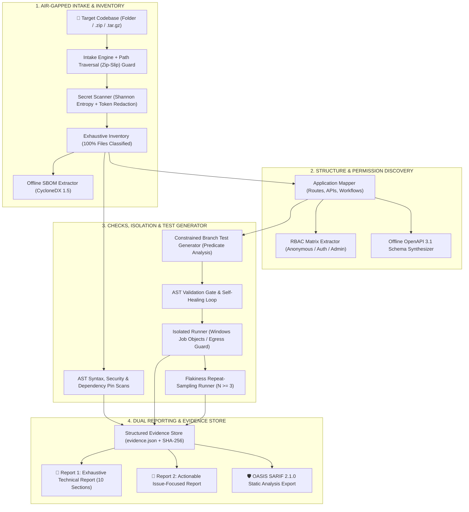

# Offline App and Website Testing Model (`offtest`)

> **Autonomous, 100% Air-Gapped Codebase Analysis, Neuro-Symbolic Test Synthesis, and Dual-Report Engine**

[](https://python.org/)
[](LICENSE)
[](tests/)
[](BLUEPRINT.md)
[](offtest/checks/sandbox_interceptor.py)

---

## 📌 Executive Overview

**`offtest`** is an offline pipeline and verification engine engineered to ingest, catalog, analyze, and test application repositories **without sending a single byte of source code, configuration, secrets, or telemetry over external networks**.

Built directly against the **[Master Blueprint](file:///c:/Users/visha/Downloads/Testing%20model/BLUEPRINT.md)**, `offtest` implements a **Facts-First, Neuro-Symbolic Architecture**:
- **Deterministic Truth:** AST analysis, CycloneDX 1.5 SBOM extraction, route/API parsing, and native OS sandboxing provide verifiable ground truth.
- **Constrained Synthesis:** Generates self-healing branch tests for uncovered conditional logic without hallucinations or untracked claims.
- **Honest Gap Accounting:** Explicitly distinguishes **Observed** facts from **Inferred** or **Unverified** relationships, measuring coverage across 7 distinct dimensions.

---

## 🏗️ Architecture & Pipeline Flow



---

## 🌟 Core Capabilities

### 1. Strict Offline Air-Gap Enforcement
- **Multi-Layer Defense in Depth:** Active proxy sinkholes (`HTTP_PROXY`, `HTTPS_PROXY`, `ALL_PROXY`, `PIP_NO_INDEX=1`, `npm_config_offline=true`).
- **Python-Level Socket Interceptor:** Injects `sitecustomize.py` to block raw TCP (`connect`), UDP (`sendto`), and DNS (`getaddrinfo`) calls to non-loopback addresses while allowing safe local mocks (`127.0.0.1`, `localhost`).
- **Host Credential Isolation:** Redirects `USERPROFILE`, `HOME`, and `APPDATA` to ephemeral sandbox folders, preventing untrusted scripts from reading `~/.ssh` or `~/.aws`.
- **Windows Job Object Containment:** Native Windows Job Objects (`JOB_OBJECT_LIMIT_KILL_ON_JOB_CLOSE`) ensure that on timeout or cancellation, all child processes are killed cleanly with zero orphans.

### 2. Offline Software Bill of Materials (SBOM)
- Scans `requirements.txt`, `package.json`, `package-lock.json`, `poetry.lock`, and `Cargo.lock`.
- Formats dependencies into CycloneDX 1.5-compatible offline component catalogs with license resolution and unpinned version alerts (`CWE-1357`).

### 3. Application Structure & RBAC Discovery
- Maps routes, pages, REST endpoints, and feature toggles.
- Categorizes evidence into three strict states:
  - `Observed`: Explicitly present in routes, decorators, or config.
  - `Inferred`: Deduced through naming conventions and relationships.
  - `Unverified`: Lacking runtime confirmation.
- Reconstructs complete **OpenAPI 3.1 Specifications** and **Role-Based Access Control (RBAC)** permission matrices without hitting remote servers.

### 4. Constrained Branch Test Synthesis & Self-Healing
- Analyzes Abstract Syntax Tree (AST) conditional predicates (null checks, range comparisons, boolean guards).
- Synthesizes syntax-validated, target-specific unit test suites.
- Gates tests against an AST anti-tautology filter to ensure tests assert genuine behavioral requirements.

### 5. Flakiness Repeat Sampling & Quarantine Runner
- Runs test suites across multiple repeat iterations ($N \ge 3$) under isolated environments.
- Automatically isolates and quarantines non-deterministic/flaky tests to prevent blocking release pipelines.

### 6. 7-Dimension Honest Coverage Model
The model accounts for testing coverage honestly with explicit denominators and documented gap reasons:
1. **Repository Inventory Coverage:** Percentage of repository files classified and inspected.
2. **Static Analysis Coverage:** Percentage of parseable code files subjected to security and syntax rules.
3. **Test Suite Execution Coverage:** Discovered vs. executed vs. blocked test suites.
4. **Statement/Branch Code Coverage:** Explicitly marked `Unavailable` if no offline LCOV/cobertura artifact exists (zero false claims).
5. **Workflow Coverage:** Documented end-to-end user workflows tested.
6. **Feature Coverage:** Identified features with verified test anchors.
7. **Branch Predicate Coverage:** Conditional branches exercised vs. synthesized.

---

## 🚀 Quickstart & Direct Execution

### 1. Prerequisites
- **Python 3.10+** (Standard Library, `click`, and `pydantic`)
- **Git** (for local revision and branch diffing)

Install in editable mode:
```powershell
pip install -e .
```

---

### 2. CLI Usage

#### Standard Assessment
Assess any local repository or directory (e.g. your application or the sample web app):
```powershell
python -m offtest assess "C:\path\to\your\project"
```

#### Assessment with Flakiness Quarantine
Perform multi-run repeat sampling ($N \ge 3$) to detect and quarantine non-deterministic tests:
```powershell
python -m offtest assess "C:\path\to\your\project" --detect-flaky
```

#### Approve Script Execution on Bare Host
By default, untrusted scripts are blocked from running on bare metal. To permit local test suite execution:
```powershell
python -m offtest assess "C:\path\to\your\project" --allow-scripts --accept-no-kernel-isolation
```

#### Save Reports to a Dedicated Folder
Specify custom output directories matching your project:
```powershell
python -m offtest assess "C:\path\to\your\project" --out "my_project_reports"
```

#### Reproduce Reports from Existing Evidence
Reconstruct Markdown and SARIF reports from saved runs without re-running checks:
```powershell
python -m offtest report run_20261024_072830_f0ea80 --out "./reproduced_reports"
```

#### Verify Offline Air-Gap Controls
Test socket sinkholes, DNS blocking, and host isolation on your current environment:
```powershell
python -m offtest verify-offline
```

#### View Offline Tool Manifest
List all discovered compilers, runtimes, linters, and packages installed locally:
```powershell
python -m offtest manifest
```

---

## 📂 Generated Report Outputs

Every assessment produces four synchronized artifacts:

1. **`REPORT_1_DETAILED.md` (Technical Investigation Report):**  
   Exhaustive 10-section report detailing file dispositions, complete CycloneDX SBOM, OpenAPI specifications, RBAC matrix, local git branch diffs, execution logs, and the 7-dimension coverage breakdown.

2. **`REPORT_2_ISSUES.md` (Actionable Issue-Focused Report):**  
   Prioritized remediation punch-list grouped by severity (`Critical`, `High`, `Medium`, `Low`, `Informational`) with exact file paths, line numbers, CWE taxonomy, CVSS estimates, reproduction evidence, and suggested fixes.

3. **`REPORT_3_WORKFLOWS.md` (Application Workflow & Journey Report):**  
   Catalog of end-to-end user journeys, reactive state management pipelines (NgRx / Redux / Store), routing transitions, interactive Mermaid diagrams, failure-mode analysis, and workflow test coverage gaps.

4. **`results.sarif` (OASIS SARIF 2.1.0):**  
   Standard static analysis results format compatible with GitHub Code Scanning, SonarQube, and CI/CD security dashboards.

---

## 📁 Repository Directory Structure

```
Testing model/
├── offtest/
│   ├── core/
│   │   ├── config.py              # Timeouts, environment flags, sensitive data regexes
│   │   ├── models.py              # Pydantic data schemas (SBOM, RBAC, Findings, Inventory)
│   │   └── evidence_store.py      # Immutable JSON evidence store & cryptographic verification
│   ├── intake/
│   │   ├── intake.py              # Directory & archive intake with Zip-Slip path sanitization
│   │   ├── git_manager.py         # Local-only Git branch and tag comparison
│   │   └── safety.py              # Shannon entropy secret scanner & token redaction
│   ├── inventory/
│   │   ├── classifier.py          # Dispositions (analyzed, excluded, binary, generated)
│   │   ├── engine.py              # Exhaustive file crawler
│   │   └── sbom.py                # CycloneDX 1.5 offline dependency extractor
│   ├── discovery/
│   │   ├── app_mapper.py          # Route, API, and workflow discovery
│   │   └── rbac_and_schema.py     # RBAC permission matrix & OpenAPI 3.1 synthesizer
│   ├── generator/
│   │   └── test_generator.py      # AST conditional predicate parser & test synthesizer
│   ├── checks/
│   │   ├── isolated_runner.py     # Subprocess containment, Windows Job Objects & proxy sinkholes
│   │   ├── sandbox_interceptor.py # sitecustomize.py raw TCP/UDP/DNS socket blocker
│   │   ├── static_checks.py       # AST syntax validator, dangerous call checks, unpinned deps
│   │   ├── test_adapter.py        # Framework discovery (pytest, unittest, jest)
│   │   ├── flakiness.py           # Multi-run repeat sampling & test quarantine engine
│   │   └── planner.py             # Check orchestrator & offline toolchain manifest
│   ├── coverage/
│   │   └── evaluator.py           # 7-dimension coverage accounting with explicit gap tracking
│   ├── reports/
│   │   ├── detailed.py            # Report 1 (Exhaustive technical document)
│   │   └── issue_focused.py       # Report 2 (Actionable punch-list)
│   ├── orchestrator.py            # End-to-end multi-stage pipeline coordinator
│   └── cli.py                     # Click-based CLI entrypoint
├── tests/                         # Pytest test suite (73 tests covering all 16 components)
├── sample_repos/                  # Fixture applications used for regression and smoke testing
├── BLUEPRINT.md                   # Formal specification & architectural blueprint
└── pyproject.toml                 # Package configuration & dependencies
```

---

## 🧪 Running the Test Suite

To run all 73 self-tests verifying air-gap isolation, secret redactors, AST parsers, and report generators:

```powershell
python -m pytest
```

---

## ⚖️ Acceptance Criteria Conformance

| Acceptance Criterion | Verification Status | Implementation Engine |
| :--- | :---: | :--- |
| **Strict Offline Networking** | ✅ Verified | `IsolatedRunner` + `sandbox_interceptor.py` + sinkhole proxies |
| **Offline CycloneDX SBOM** | ✅ Verified | `SBOMGenerator` (npm, pip, cargo, poetry) |
| **RBAC Matrix Discovery** | ✅ Verified | `RBACAndSchemaExtractor` |
| **OpenAPI 3.1 Synthesis** | ✅ Verified | `OpenAPISpecRecord` generator |
| **Flakiness Quarantine** | ✅ Verified | `FlakinessRepeatSampler` ($N \ge 3$) |
| **Branch Test Synthesis** | ✅ Verified | `ConstrainedTestGenerator` (AST condition solver) |
| **100% File Classification** | ✅ Verified | `InventoryEngine` (all files assigned explicit dispositions) |
| **Zero Remote Git Fetches** | ✅ Verified | `GitManager` (strictly local refs and diffs) |
| **Dual Synchronized Reports**| ✅ Verified | Generated simultaneously from unified `evidence.json` |
| **Report Reproducibility** | ✅ Verified | `python -m offtest report <run_id>` |
